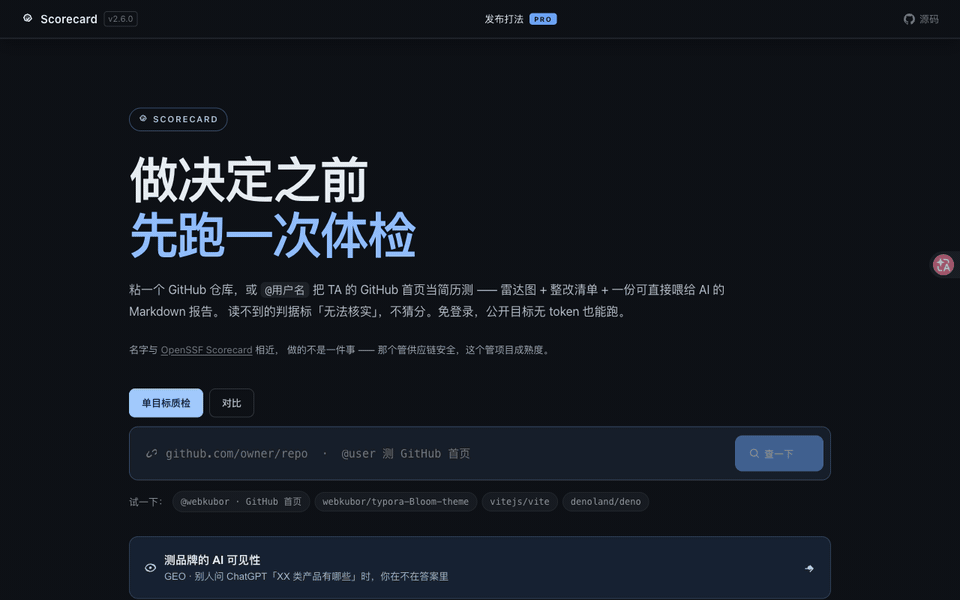
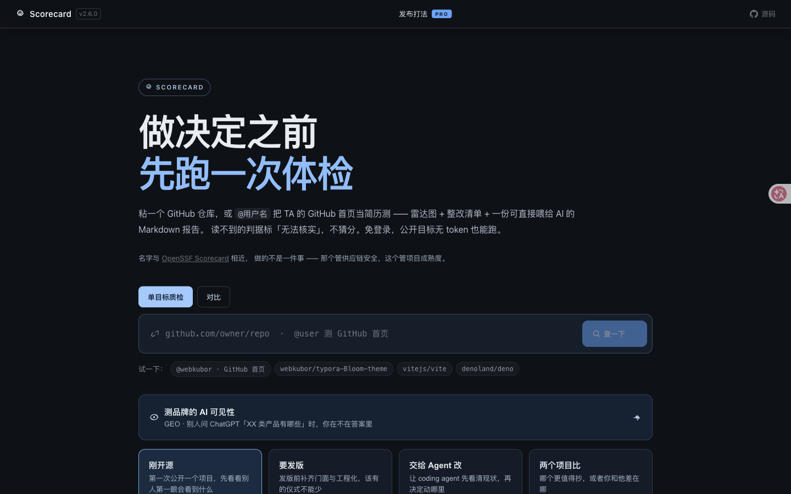

<p align="center"><picture><source media="(prefers-color-scheme: dark)" srcset="https://cdn.jsdelivr.net/gh/webkubor/free-imgbed@main/scorecard/mark-v3-dark.svg"></picture></p>

# Scorecard

[](./LICENSE)
[](https://github.com/supercli-site/scorecard/stargazers)
[](https://scorecard.supercli.site)
[](https://github.com/supercli-site/scorecard/issues)

> **做决定之前，先跑一次体检。**
>
> 粘一个 **GitHub 仓库 / npm 包名 / 网页 URL / @GitHub 用户名**，几秒钟拿到一份体检报告：
> 九维度雷达图、按「影响÷成本」排序的整改清单，一份可直接粘给 AI 的 Markdown 报告。
> 免登录，公开仓库无需 token。

**它和 [OpenSSF Scorecard](https://scorecard.dev/) 是什么关系？** 名字撞了，做的不是一件事。
OpenSSF 那个管**供应链安全** —— 依赖有没有钉版本、token 权限多大、发包有没有签名，
面向企业安全审计。本项目管**项目成熟度** —— 门面试不试人、文档齐不齐、
发布工程规不规范，面向「我这个仓拿出手吗、能不能交给别人用」。
两个方向侧重点不同，部分检查（如 CI、许可）有交集，互不替代。

五套引擎（GitHub 仓库 9 维 / npm 7 维 / 网页 9 维 / GitHub 首页 7 维 / GEO 4 维）
**判据互不通用** —— 把 npm 包的「周下载」塞进 GitHub 仓的「star 增速」位会系统性误判，
拿仓库的九维去评一个人的门面同样会失真。

**五个入口，对应五种「我该拿它干嘛」**：

| 我要做的事 | 入口 | 它会告诉我 |
|---|---|---|
| 刚开源，不知道差在哪 | <https://scorecard.supercli.site> | 别人第一眼会看到什么、文档够不够用 |
| 要发版，想补齐门面 | 同上 | tag / Release / CHANGELOG / CI 少了哪套仪式 |
| 把 GitHub 首页当简历经营 | 同上，输 `@用户名` | 首页缺哪块：README 简历感、可视化组件、活跃轨迹 |
| 交给 coding agent 改 | [`/skill.md`](https://scorecard.supercli.site/skill.md) | 让 agent 按同一套判据先看清现状 |
| 一堆仓库，先修哪个 | `/api/scorecard/compare` | 逐维度差分，哪边领先、差在哪 |

**线上版**：<https://scorecard.supercli.site>

<p align="center">
  
  <br><sub>v2.6.0 实录：粘一个仓库，几秒出雷达图与整改清单（<a href="https://github.com/supercli-site/scorecard/releases/download/v2.6.0/scorecard-v2.6.0-demo.mp4">MP4 原片</a>）</sub>
</p>

<p align="center">
  
</p>

## 它回答什么问题

「我这个项目，到底差在哪？」（项目 / 包 / 站点都行）

star 数只告诉你结果，不告诉你原因。Scorecard 按目标类型拆各套独立判据，
每条结论只看**客观证据**——API 拿得到、文件在不在、状态码是多少：

| 入口 | 引擎 | 维度数 | 主要看什么 |
|---|---|---:|---|
| GitHub 仓库 | `server/audit.js` | 9 | description / topics / CI / issue 响应 / llms.txt 等 |
| npm 包 | `server/audit-npm.js` | 7 | registry 元数据 + 周/月下载 + 文档 + 安全 + AI 可读性 |
| 任意网页 | `server/audit-page.js` | 9 | 含 **AI 识别**（llms.txt / schema.org）、**爬虫根目录**（robots / sitemap / .well-known / favicon）、**WebMCP 友好性**（mcp.json / ai-plugin / openapi）等 |
| GitHub 个人首页 | `server/audit-profile.js` | 7 | 把 `github.com/<user>` 当简历测：身份门面 / 首页自述 / **可视化**（stats 卡 / streak / 技能图标 / 贪吃蛇）/ 活跃度 / 作品集 / 影响力 / 链接触达 |
| 品牌 | `server/audit-geo.js` | 4 | AI 答案里的提及率 / 引用率 / 竞品份额 / 评价倾向（见下节） |

五套维度**互不通用**——把 npm 包的"周下载"塞进 GitHub 仓的"star 增速"位会系统性误判，
所以引擎、判据、报告模板各自独立。

输出不是一个分数了事，而是一份**可执行清单**——每条都带证据和「改完预计 +X 分」，
还能一键复制成可直接交给 AI 的整改 prompt。

## 「无法核实」不等于「有问题」

这是本项目和多数打分工具最不一样的地方。

打分工具量的是自己看得见的东西。所以公开 API 读不到的——需要 push 权限的 GitHub
traffic、没配 homepage 的官网、抓超时的 robots——在别的工具里通常被记成 0 分。
**那是在拿量具的盲区给项目扣分。**

Scorecard 的做法：读不到的判据从分母里剔除，该维度标 `score: null` +「无法核实」，
报告单列一份「我们看不到的清单」和 `manual` 手动核验项。后果要说准确：
**总分只反映可核实的证据。未知项既可能让分数偏高，也可能偏低——
它不是真实水平的上界或下界，完整信息下的分数可能高于或低于它。**

同样的纪律贯穿全引擎：

- GitHub traffic 需要 push 权限，公共质检永远读不到 → 归入 manual，不扣分
- tag 超过取样上限时判不准 → 那几分从满分里剔除，而不是记 gap
- GEO 这一轮模型一次都没调 `web_search` → 「引用率」标无法核实而不是 0%
  ——**量具没通电和读数低，是两回事**

## 九维度是怎么定出来的

这套维度不是拍脑袋列的。每一维对应一个可外部核实的「陌生人用你的项目会卡在哪」的问题，
设计上受三条约束：

1. **只判客观项。** 判据限定在 API 拿得到、文件在不在、状态码是多少。
   主观项（「10 秒看不看得懂」「logo 是否与品牌统一」）判不了可复现，
   单列在 `skills/project-maturity-audit/`，不进网页引擎。
2. **各套引擎互不通用。** GitHub 仓库 9 维 / npm 7 维 / 网页 9 维 / GitHub 首页 7 维 / GEO 4 维，判据各自独立。
3. **分数可被人推翻。** 每条结论都附证据原文与来源 URL，不同意可以对着证据直接反驳。

计分口径是「拿到多少判据就归一化多少」（`normalizeDim(score, unv)`），
不是拿满分 10 去减：读不到 README，就把那几条从**分母**里剔除，而不是记 0 分。

## 判据出处：与公开标准的对照

我们不是自创了一套「神秘评分」。每一维的判据都能在下面的公开标准里找到对应条款，
标准本身不适用时（如 OpenSSF 只管供应链安全）我们明确不套用。

| 维度 | 我们实际看什么 | 对应公开出处 |
|---|---|---|
| 门面 | description / topics / homepage / README 首屏图与徽章 | GitHub 仓库元数据；topics 即站内检索分类入口 |
| 分发 | registry 发布 / README 安装命令 / release 可下载产物 | [OpenSSF Scorecard](https://scorecard.dev/) · Packaging |
| 发布工程 | 版本 tag / GitHub Release / CHANGELOG / CI 最近一次**已完成**结论 | [SemVer 2.0.0](https://semver.org/spec/v2.0.0.html)、[Keep a Changelog 1.1.0](https://keepachangelog.com/en/1.1.0/)、OpenSSF · CI-Tests |
| 质量护栏 | test / lint / typecheck 声明、独立测试目录 | [NIST SP 800-218](https://csrc.nist.gov/pubs/sp/800/218/final) · PW（Produce Well-Secured Software） |
| 社区卫生 | LICENSE / CONTRIBUTING / issue 模板 / issue 积压时效 / 最后提交 | OpenSSF Scorecard · Security-Policy、Maintained |
| 文档 | 安装 / 快速开始 / API 参考 / FAQ 四件套 | 通用开源文档基线（细则见 SKILL.md ⑥） |
| 安全 | SECURITY.md / 根目录误提交 .env / .gitignore | OpenSSF Scorecard · Security-Policy |
| 度量 | star / release 累计下载 / fork / homepage | 采用信号。**star 只当「有人在用」，不当质量证据** |
| AI 可读性 | AGENTS.md / llms.txt / Copilot 指令 / 官网 robots 是否放行 AI 爬虫 | [llms.txt 规范](https://llmstxt.org/)、[RFC 9309](https://www.rfc-editor.org/rfc/rfc9309.html) |

**引用清单**

- [OpenSSF Scorecard](https://scorecard.dev/) —— 源码
  [ossf/scorecard](https://github.com/ossf/scorecard)，检查项说明
  [docs/checks.md](https://github.com/ossf/scorecard/blob/main/docs/checks.md)
- [NIST SP 800-218 · Secure Software Development Framework (SSDF) v1.1](https://csrc.nist.gov/pubs/sp/800/218/final)
  —— 四个 practice group：PO / PS / PW / RV
- [RFC 9309 · Robots Exclusion Protocol](https://www.rfc-editor.org/rfc/rfc9309.html)
  （2022-09，Standards Track）—— 我们的 robots 判定直接照它实现：按 `user-agent`
  分组做大小写不敏感匹配、命中多条规则时合并、**4xx 视为 unavailable，此时爬虫 MAY
  访问任意资源**，所以站点返回 404 时我们记「默认放行」而不是「屏蔽」
- [llms.txt 提案](https://llmstxt.org/) —— 第 9 维 `llms.txt` 判据即来自此
- [Semantic Versioning 2.0.0](https://semver.org/spec/v2.0.0.html)、
  [Keep a Changelog 1.1.0](https://keepachangelog.com/en/1.1.0/)

> 引用粒度：上表列到 practice group / 检查项一级是确定的。若要在文案里引用 NIST
> 的具体 practice ID（如 `PW.4`）或 SLSA 的具体 level，落地前请对照原文核编号 ——
> 框架改版会动编号，引用错编号比不引用更伤可信度。

## 这个工具不做什么

主动划清边界，比多认领几个维度更能建立信任：

- **不做安全漏洞扫描。** 不跑 SCA、不查 CVE、不做 SAST、不扫 Dangerous Workflow。
  那是 [OpenSSF Scorecard](https://scorecard.dev/)（Pinned-Dependencies、
  Token-Permissions、Signed-Releases 等）与 [OWASP SCVS](https://scvs.owasp.org/scvs/) 的范围。
  我们的安全维只做最表层三项：`SECURITY.md` 是否存在、根目录是否误提交 `.env`、有无 `.gitignore`。
- **不做 provenance 验证。** 不核验构建产物来源，那需要构建平台侧配合。
- **不做主观判断。** 判不了可复现的项交给 `skills/project-maturity-audit/`，不进引擎。
- **GEO 不进排行榜。** 那会把「谁在盯哪些竞品」公开出去。

## GEO —— 测品牌在 AI 答案里的可见度

前面几套测的是「你自己的东西做得好不好」，GEO 测的是**别人问 AI 时你会不会被提到**。
入口：<https://scorecard.supercli.site/#/geo>，或落地页顶部那张卡片。

要四个输入：品牌名、自有域名、**用户会问的问题清单**、竞品。四维：

| 维度 | 怎么算 | 为什么这么算 |
|---|---|---|
| 提及率 | 品牌名出现在答案正文里的问题占比 | 最直接的"在不在" |
| 引用率 | 品牌域名出现在引用来源 URL 里的占比 | 被引用是转化路径，比被提及更值钱 |
| 竞品份额 | 你被提及的次数 ÷ 全部品牌被提及次数 | 单看提及率会被「品类很小」骗过去 |
| 评价倾向 | 出现位置的措辞：正面 / 中性 / 负面 | 只在有负面样本时才给分，没有就标「无法核实」 |

**判据只有两种硬证据**：品牌名在正文里、域名在引用 URL 里。刻意不让 LLM 自评
「这个品牌有名吗」——那是最容易被编出来的一类数字。拿不到证据的维度一律标
`score: null` + 「无法核实」，不猜。

两个容易踩的坑，引擎会挡：

- **问题必须是品类问题**，不是品牌词。问「museav 怎么样」模型会顺着你的问题去提它，
  数字好看但一文不值。所以要问「有哪些好用的 AI 视频生成工具」。
- **不给竞品就算不出份额**。此时分母只有你自己，恒等于 100% —— 引擎直接标「无法核实」而不是给你一个满分。

### 跑 GEO 要花钱，所以线上实例不配 key

GEO 每次查询都要调付费 LLM API。线上实例**故意不配任何 key**：它只跑离线 fixture
（报告首行强制标注「这份是假数据」）和读本地存下来的历史趋势，零花费。
完整功能在本地跑：

```bash
export SCORECARD_GEO_ANTHROPIC_KEY=sk-ant-xxx   # 或 _OPENAI_ / _GEMINI_ / _PERPLEXITY_
bun run server
```

`GET /api/geo/providers` 会告诉你本机哪几路配好了（只回报就绪与否，**永不回显 key**）。
没配也可以用 `provider=offline` 看报告长什么样。

GEO 不进排行榜也不进 trending —— 那会把「谁在盯哪些竞品」公开出去。

### 用本机网关跑（magpie）

如果本机装了 [magpie](https://github.com/webkubor/magpie) 这类 Anthropic 协议的
LLM 网关，不用去申请 key，直接指过去：

```bash
export SCORECARD_GEO_MAGPIE_BASE=http://127.0.0.1:3425
export SCORECARD_GEO_MAGPIE_KEY=<网关的 caller key>
export SCORECARD_GEO_MAGPIE_ALLOW_LOCAL=1        # 显式确认「我知道这是本机地址」
export SCORECARD_GEO_MAGPIE_MODEL=modelgo-gateway/claude-haiku-5.5
export SCORECARD_GEO_MAGPIE_MAX_TOKENS=4000   # 默认值；2000 会把来源列表截断成零
bun run server
```

默认模型是 `modelgo-gateway/claude-haiku-5.5`，**因为这是实测唯一每次都真调用 `web_search` 的一路**（4/4）。
换模型前先探一次：`node scripts/probe-magpie.mjs <model>`。`/v1/models` 列出来的**不是能力清单** ——
实测 `opencode-go/*` 额度耗尽、`modelgo-gateway/gemini-3.6-flash` 直接 400、
上一个默认值 `modelgo-gateway/gpt-5.4` HTTP 200 但回空 content 还白烧 token。照着列表配会得到一个「看起来配好了、跑起来只是全灭」的适配器。

三条硬规矩，都不是洁癖，是被实测打过脸：

| 规矩 | 为什么 |
|---|---|
| **不许用 `claude/*` 池** | 那一池走的是你自己 Claude Code 会话的额度。GEO 跑一次就烧一次写代码的额度，编辑器当场不可用（实测直接回 `rate_limit_error`）。这条是硬的，代码里直接拒。**别被名字骗了** —— `modelgo-gateway/claude-*` 不在这一池：它在 `~/.config/magpie/providers.json` 里有独立 endpoint 和 `mgk_` 开头的 ModelGo key，计费在 ModelGo 那边，跟本机会话不是一回事。 |
| **不许用 `group/*` 路由组** | 网关对路由组做动态选择。实测同一个 `group/mian-model-group` 先落 `codex/gpt-6-astra`、三分钟后落 `claude/claude-opus-5-5`。趋势图会把两个不同模型的结果画成一条线 —— 那条线量的不是同一个东西的变化。**钉死一个具体模型 id。**（它能漂进禁用池，所以是**禁用**，不是只在发起请求时拒绝。） |
| **只认 loopback 地址，且必须显式 `ALLOW_LOCAL=1`** | 生产在服务器、网关在你电脑上，两者隔着网络。这里是**白名单**：地址必须能从 URL 里证明是 `127.0.0.1` / `localhost` / `::1`，否则不放行 —— 不是「没禁就放行」。`0.0.0.0` 也踢掉，那是本机所有网卡，局域网够得着。 |

**引用分强弱两档。** 强证据有两个来源，都收：`web_search_tool_result` 里逐条列出的检索结果，
和正文块自带的结构化 `citations[]`（Anthropic 服务端给每句话挂的出处）。实测默认那路每次都返回后者，
一次 3~7 条。弱证据是模型自己在句子里写的裸 URL —— 可能是凭记忆写的，甚至是编的 ——
所以它单列提示，**不进分数**。把幻觉算成可见度，比不测更糟。

**模型没检索 ≠ 没人引用你。** 报告里另有一条：如果这一轮所选模型一次都没调用 `web_search`
（实测 `modelgo-gateway/deepseek-v4-pro` 就会回一段像模像样的正文、HTTP 200、从不用检索工具），
「引用率」标 **无法核实**，而不是 0%。一个是量具没通电，一个是读数低，混同就没有意义了。
提及 / 份额 / 倾向不依赖检索，照常给分。

### 一次测一个品牌

品牌清单在 `data/geo-brands.json`，出自 [Social Hub](https://github.com/webkubor/social-hub)
的 IP 矩阵（12 个平台账号归并成 5 个品牌）。有了它，「测某个品牌」是一条命令：

```bash
scorecard geo --list                    # 看有哪些品牌和问题
scorecard geo --brand 山鬼映画 --provider magpie
```

注意 `--q` 是可以重复给的，且**必须是品类问题而不是品牌词** —— 问「X 怎么样」模型会顺着
你的问题去提它，数字好看但一文不值。清单里的问题来自 Social Hub 的账号定位，不是从 bio 自动生成的。

### 检索基线追踪（geo-track，本地）

上面的 `geo` 问的是「AI 答案里有没有提到你」；`geo-track` 问的是另一件事：**用一组固定问题去检索，返回的来源里有没有你的站点、仓库或包页**，并在整改后按窗口复测。两者口径不同，报告分开写。

先写一份 track.json。可运行模板在 [`examples/geo-track.track.json`](examples/geo-track.track.json)（npm 包内同路径），复制后改成自己的：

| 字段 | 要求 |
|---|---|
| `id` | 小写字母、数字、连字符，2–64 位；就是数据目录名 |
| `entries[]` | 每个入口一个 `id`；`sources` 是「算自己的」URL 前缀（host + 可选路径），`kind` 取值见下 |
| `queries[]` | 固定题：`id`（字母数字 `._-`，不能含 `/`）、`entry`、`kind`（`brand` 或 `category`）、`query` |
| `window` | 可选：`start`/`end`（YYYY-MM-DD）+ IANA `timezone`；正式复测只能在窗口内 |
| `supplementary[]` | 可选补充题：编号不能和固定题重名，不进冻结哈希，也没有历史基线 |

`kind` 词表：`owned` `owned_site` `owned_repository` `owned_package` `owned_gallery` `official_site` `official_repository` `official_gallery` `verified_third_party_directory` `verified_third_party_gallery` `verified_third_party_package_page` `verified_third_party_org_mirror`。词表外或留空一律当未归类，**不算命中**。

```bash
scorecard geo-track init track.json                       # 冻结查询（之后改一个字都会拒绝采集）
scorecard geo-track capture <id> --kind baseline          # 第 1 天：基线
scorecard geo-track log <id> --type remediation --entry A --what "补安装指南" --url ...
scorecard geo-track capture <id> --kind retest            # 只允许在 track.window 内；窗口外用 --kind preview
scorecard geo-track report <id> --out report.md           # 有限比较；失败查询单列，不算零命中
```

- 纯本机执行，默认调用本机 `magpie web_search`；数据在 `~/.scorecard/geo`（`SCORECARD_GEO_DIR` 可改），不进仓库、不上传。
- 快照只新建不覆盖，采完写 sha256 清单，比较前先校验。采集中断留下的残目录（没有清单）不算快照，不会挡住重采。
- 每份快照冻结采集当时的 `sources` 归类规则：事后改 sources 不会倒改旧快照的结论；前后快照规则不同的题单列为「归类规则已变，不可比较」。旧版本采集、没有规则快照的快照会按当前规则重算，报告明确标注「不保证可比」。
- 原始响应丢失的旧基线可用 `import-derived` 导入，报告会永久标注「原始响应缺失」。CSV 里没有来源行的查询记为缺失，不算零命中；若某题确实采到但零来源，用 `--coverage <file>`（`query_id` 列或每行一个 id）显式登记覆盖。
- URL 出现在检索响应里不代表搜索排名、收录、安装或因果；少量样本不构成统计显著。
- 属于社区版能力，自托管免费。

**本地看板（geo-dashboard）**：把上面的 track、基线、整改、安装证据与快照放到一屏里看。

```bash
scorecard geo-dashboard                                   # 打开 http://127.0.0.1:54447/ （只绑回环地址）
scorecard geo-dashboard export <id> --out geo.html        # 导出自包含 HTML，不用起服务
```

- 只读：不采集、不写数据目录；读快照前照样走 sha256 清单校验，校验失败的快照标成不可用，不参与统计。
- 只在本机：非回环地址拒绝启动，也拒绝 Host 头不是回环的请求；没有公网开关，远程查看请用 SSH 端口转发。
- 页面零 JavaScript、零外部资源；原始检索响应、未登记的第三方 URL（只给数量）和本机路径都不会出现在页面里。

## 对比模式

把两个目标放一起跑，输出维度差分 + 独有 gap 清单——主用例是**测试环境 vs 线上环境**：

- 9 维逐条 Δ，A 独有 / B 独有 gap 分开列
- 报告里自带 "把 A 补到 B 的水准" 的 AI prompt
- 分享 URL：`https://scorecard.supercli.site/?share=<A>&compare=<B>&type=page` —— 直接扔 IM 即可

## 快速开始

先克隆仓库并进入项目目录，安装 [Bun](https://bun.sh/) 后运行：

```bash
git clone https://github.com/supercli-site/scorecard.git
cd scorecard
bun install          # 或 npm install
bun run build        # 构建前端到 dist/
bun run server       # 起后端（默认 :54445），自动托管 dist/
```

打开 <http://127.0.0.1:54445> 即可。开发模式要前后端一起：

```bash
bun run server &     # 后端 :54445
bun run dev          # 前端 :54446，/api 代理到后端
```

### 配一个只读 token（可选，但建议）

不配也能跑，走 GitHub 匿名 API（60 次/小时/IP）；配了之后限额提到 5000 次/小时。
匿名请求受限时，部分 PR / Issues 数据可能无法核实；未知项不计为零分，
分数只反映当次可核实的证据，不能预断会偏高还是偏低。

```bash
export SCORECARD_GITHUB_TOKEN=ghp_xxx   # 只需 public_repo 只读权限
bun run server
```

token 只在服务端使用，从不下发给前端。

## CLI

在上面克隆的仓库目录中，可以直接用 Node.js 运行命令行入口，无需先注册全局命令：

```bash
node bin/scorecard.mjs supercli-site/scorecard --json
```

CLI 默认访问线上免费实例 `https://scorecard.supercli.site`；要使用自托管服务，在命令后加 `--api http://127.0.0.1:54445`。在仓库目录内运行下面的命令：

```bash
# 三路审计（type 推断：URL=page，pkg 名=npm，owner/repo=github）
node bin/scorecard.mjs supercli-site/scorecard
node bin/scorecard.mjs react --type npm
node bin/scorecard.mjs https://example.com --type page

# 同一类两个目标对比
node bin/scorecard.mjs --compare-a https://test.example.com \
  --compare-b https://example.com --type page

# 报告 Markdown、CI 闸门及跳过 30 分钟缓存
node bin/scorecard.mjs supercli-site/scorecard --md > report.md
node bin/scorecard.mjs react --type npm --min 6
node bin/scorecard.mjs supercli-site/scorecard --fresh

# GEO：品牌在 AI 答案里的可见度（--q 可重复给多条问题）
node bin/scorecard.mjs geo --brand museav --domain museav.com \
  --q "有哪些好用的 AI 视频生成工具" \
  --q "有哪些能批量做小红书内容的工具" \
  --competitors runway,pika --provider perplexity
```

GEO 的 CLI 与网页同一套判据。两条它特有的约定：**没法用 `--min` 卡离线结果**
（fixture 是假数据，闸门通过与否都不说明问题，命令会直接失败），以及
**没给 `--domain` / `--competitors` 时会先提醒再跑**，对应维度标「无法核实」而不是给满分。

CLI 把对应 HTTP 端点暴露成 stdout，agent 默认动作就能跑。

## 在 PR 里做项目质检

[Scorecard PR Action](docs/pr-action.md) 可以在公开仓库的 GitHub PR 里输出九维成熟度报告。文件证据固定到 PR 当前提交，仓库级数据标明为实时状态；默认只展示报告，不因分数阻断合并。它不执行 PR 代码，也不把 PR 内容发送到 Scorecard 网站。

[查看可直接使用的工作流、权限和边界 →](docs/pr-action.md)

## GitHub 维度的 skill 互补

GitHub 仓这一路额外配 Claude skill 版（深度诊断），互补不重复：

| | 网页引擎（`server/audit.js`） | Claude skill（`skills/project-maturity-audit/`） |
|---|---|---|
| 擅长 | **广度 + 趋势**：一键扫多个仓库、可定时、看得到「上次 62 这次 78」 | **深度 + 修复**：读 README 判断首屏说不说得清、给排序后的整改清单 |
| 判据 | 只做客观项——API 拿得到、文件在不在、状态码是多少 | 主观项——「10 秒能否看懂」「logo 配色是否与品牌统一」「同品类头部差在哪」 |
| 边界 | 每个维度的 `manual` 字段标出「这几项判不了，去跑 skill」 | 每条结论必须有命令输出/文件内容/状态码支撑 |

引擎没有 LLM，判不了主观项；skill 没有并发和历史库，扫不了一批仓库、也画不出趋势。
谁都替代不了谁。

GitHub 引擎是权威：改维度必须同步三处 —— `server/audit.js`、`scripts/check-dimensions.mjs`、
`skills/project-maturity-audit/SKILL.md`，再跑 `bun run check:dimensions`。

```bash
bun run check:dimensions   # 维度名对不上就报错
```

## 部署

单个 bun 进程 + sqlite，2 核小机足够：

```ini
# /etc/systemd/system/scorecard.service
[Service]
Environment=SCORECARD_HOST=127.0.0.1        # 只监听本机，公网走隧道
Environment=SCORECARD_PORT=54445
Environment=SCORECARD_GITHUB_TOKEN=<只读 token，别写进仓库>
WorkingDirectory=/opt/scorecard
ExecStart=/root/.bun/bin/bun server/index.js
Restart=always
```

前面挂 Cloudflare Tunnel 指到 `127.0.0.1:54445`，不用对公网开端口。

### 环境变量

| 变量 | 默认 | 说明 |
|---|---|---|
| `SCORECARD_PORT` / `PORT` | 54445 | 后端监听端口 |
| `SCORECARD_HOST` / `HOST` | 0.0.0.0 | 监听地址（生产建议 127.0.0.1） |
| `SCORECARD_GITHUB_TOKEN` | – | 只读 token，提升 API 限额并解锁 PR/Issues 维度 |
| `SCORECARD_GEO_ANTHROPIC_KEY` | – | GEO 的 anthropic 路。**线上故意不配**（只读历史，零花费） |
| `SCORECARD_GEO_OPENAI_KEY` | – | GEO 的 openai 路 |
| `SCORECARD_GEO_GEMINI_KEY` | – | GEO 的 gemini 路 |
| `SCORECARD_GEO_PERPLEXITY_KEY` | – | GEO 的 perplexity 路（唯一自带来源列表的一路，引用率判得最准） |
| `SCORECARD_GEO_MAGPIE_BASE` | – | 本机 magpie 网关地址，如 `http://127.0.0.1:3425` |
| `SCORECARD_GEO_MAGPIE_KEY` | – | 网关的 caller key。**刻意不给默认值** —— 这个仓是公开的，本地开发密钥也是密钥 |
| `SCORECARD_GEO_MAGPIE_ALLOW_LOCAL` | – | 必须显式设 `1` 才允许连 loopback 网关（防止生产误配） |
| `SCORECARD_GEO_MAGPIE_MODEL` | `modelgo-gateway/claude-haiku-5.5` | 钉死的模型 id。**不许 `claude/*`，不许 `group/*`，不许 `opencode-zen-free/*`** |
| `SCORECARD_GEO_MAGPIE_MAX_TOKENS` | 4000 | 单次回答上限。调到 2000 会让默认模型被截断，来源列表清零 |
| `SCORECARD_DATA_DIR` | ./data | sqlite 存放目录 |
| `SCORECARD_BRAND` | SCORECARD | OG 图上的品牌字样 |
| `SCORECARD_SITE_URL` | scorecard.supercli.site | OG 图 CTA 里的站点地址 |

## API

全部免登录（除 GitHub 维度可加 token 升限）：

| 端点 | 说明 |
|---|---|
| `GET /api/scorecard?repo=owner/name` | GitHub 仓 9 维质检（30 分钟内同 target 复用缓存） |
| `GET /api/scorecard?type=npm&pkg=react` | npm 包 7 维质检 |
| `GET /api/scorecard?type=page&url=https://...` | 网页 9 维质检 |
| `GET /api/scorecard/report.md?type=...&...` | 同一份报告的 Markdown 版，写给 AI 助手读 |
| `GET /api/scorecard/compare?type=...&a=X&b=Y` | 两路对比，返回两份报告 + 维度 diff |
| `GET /api/scorecard/compare.md?type=...&a=X&b=Y` | 对比报告的 Markdown 版 |
| `GET /api/scorecard/history?target=owner/name` | 同一项目的历次评估与维度变化（改完再跑一次，就能看出动没动） |
| `GET /api/scorecard/stats` | 累计查询次数与平均分 |
| `GET /api/scorecard/trending` | 近 24h 热门仓库 Top 10 |
| `GET /api/scorecard/leaderboard?limit=20` | 参照榜：每个项目取最新一次质检，按分数排 |
| `GET /api/scorecard?type=geo&brand=X&q=Q1,Q2&competitors=A,B&provider=...` | GEO 4 维可见度（**不走 30 分钟缓存**，见下） |
| `GET /api/geo/trend?brand=X` | 该品牌的历史曲线，live 与 offline 两类分开返回 |
| `GET /api/geo/providers` | 本机哪几路 GEO key 配好了（不回显 key） |
| `GET /api/geo/brands` | 品牌清单（出自 Social Hub 的 IP 矩阵），CLI 与前端用它免去手抄问题 |
| `GET /og/scorecard/:owner/:repo` | 1200×630 OG 分享图（**PNG**；`?fmt=svg` 取矢量版） |
| `GET /skill.md` | Agent skill 全文（带 frontmatter），供 coding agent 直接取用 |
| `GET /api/skill` | skill 的元信息 + 安装方式 + 端点清单 |
| `GET /api/health` | 健康检查 |

**给 agent 用**：`/skill.md` 是这套判据的 skill 形态，与网页端同源。装法：

```bash
curl -sL <站点>/skill.md -o <你的 skills 目录>/project-maturity-audit/SKILL.md
```

不给「一键安装」是刻意的：各家 agent 的 skills 目录与加载机制都不一样，
猜错落点比不装更糟。

任何端点加 `fresh=1` 跳过 30 分钟缓存，强制重跑。**GEO 例外**：它每次调用都花真钱，
且离线 fixture 与真实结果不可比，所以既不吃缓存也不写进别人的缓存 —— 跑一次存一次，
趋势读历史。

## 技术栈

Vue 3（无路由库，hash 路由手写）+ Vite + Hono + `bun:sqlite`。
生产就一个 bun 进程，内存约 80MB。没有任何外部前端依赖 —— 报告以 Markdown 交付，
由服务端 `reportMarkdown()` 生成，所以前端不需要 html2canvas 这类截图库。

## 身世

这个项目原本是 `github-accounts-manager`（一个 GitHub/GitLab 多账户与 token 管理中台）
里的一个页面。两个产品挤在一个仓库，导致对外传播的门面顶着「账户管理」的名字和标签，
而私有的 token 管理代码躺在公开仓库里。2026-08-20 拆开：Scorecard 独立公开，
账户管理回到私有仓库。

## License

MIT
